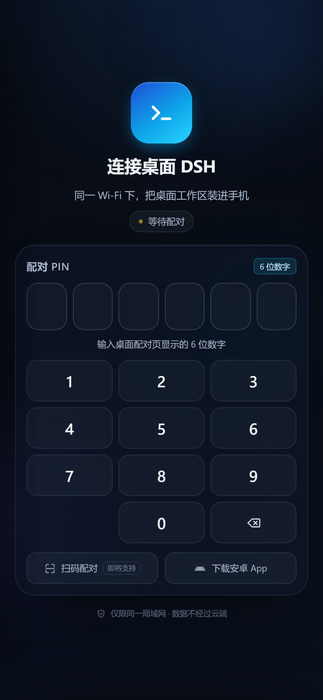
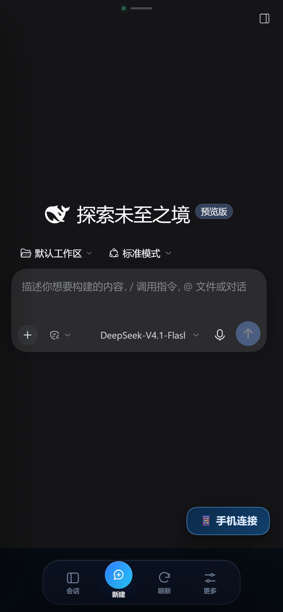
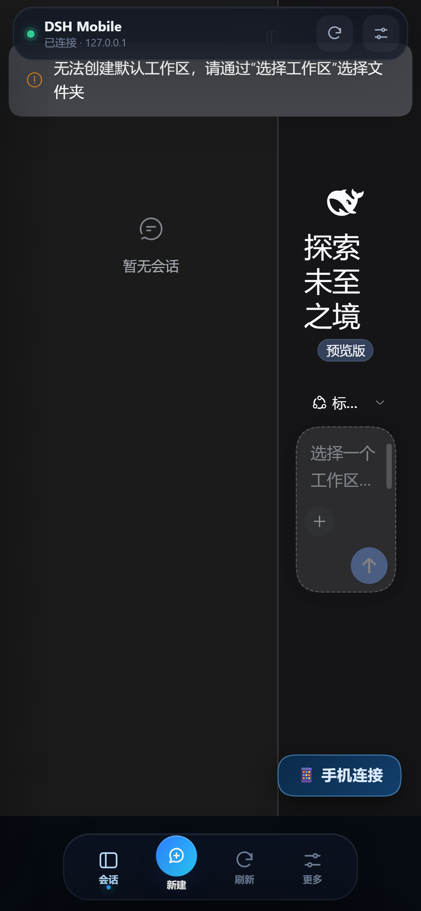
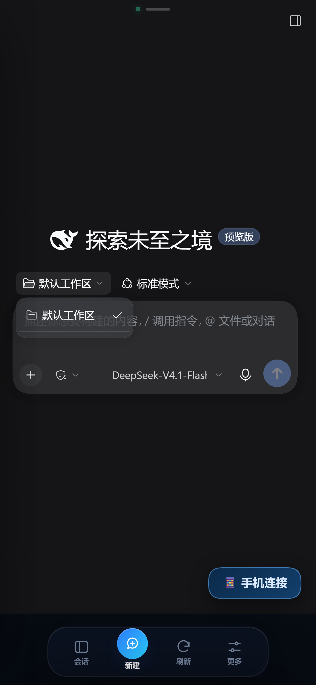
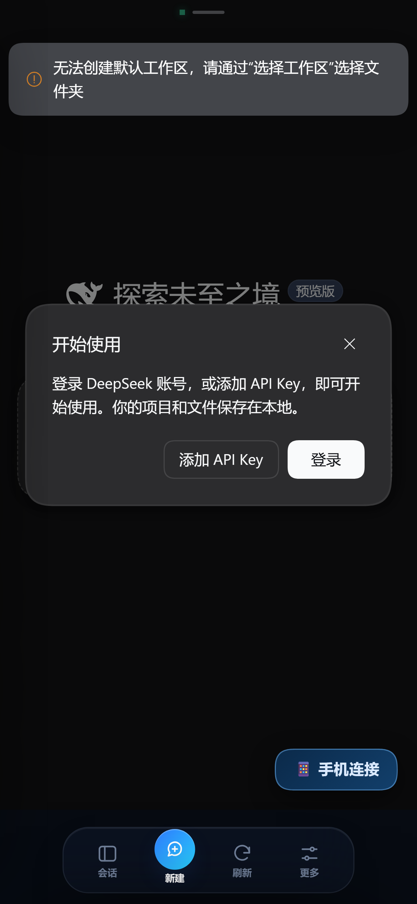
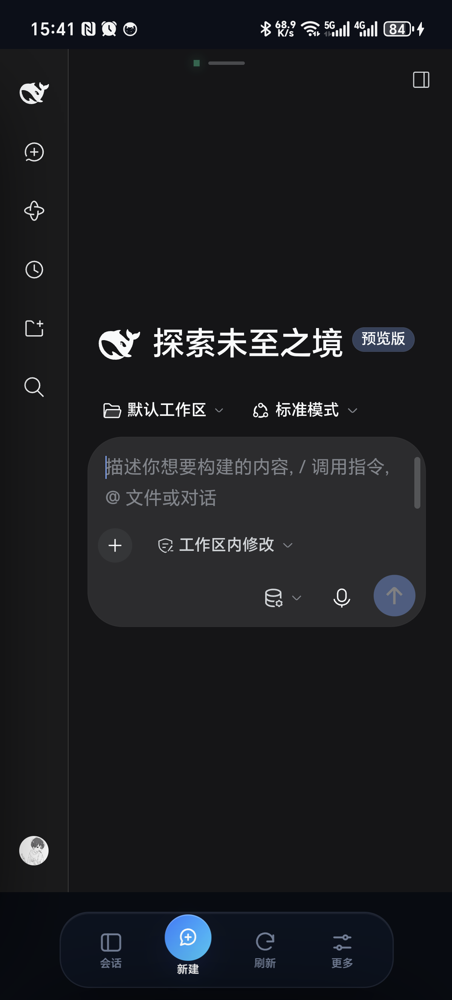
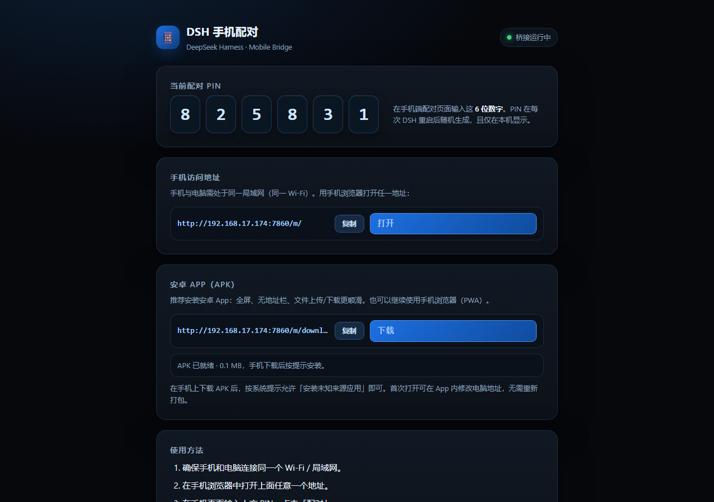
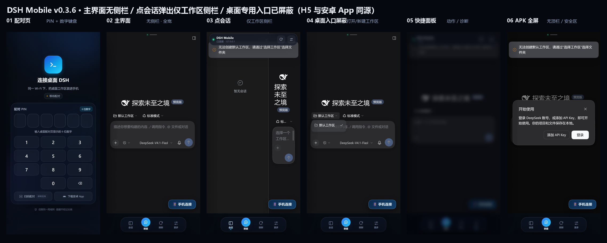

# DSH Mobile Bridge · 用手机遥控桌面 DeepSeek Harness

一个 **DeepSeek Harness（DSH）桌面端插件** + **手机 App**（安卓 APK / PWA 网页）：
在桌面 DSH 进程内启动一个受 PIN 配对保护的局域网网关，把桌面正在运行的 DSH Web GUI
安全地反向代理到同一 Wi-Fi 下的手机，并提供一个接近原生的手机外壳（全屏内嵌真实 GUI、
移动端交互优化、可安装 APK / 添加到主屏幕）。手机端看到的就是桌面 DSH 的真实界面与真实会话，
因此可以直接用手机聊天、查看/切换会话、审批权限、停止任务、使用全部插件功能。

> v0.3.6 · 仅限**同一局域网**（无云端中继）· 手机端为「沉浸式原生」重设计（H5 与安卓 App 同源）· 安卓安装包为本地自签名侧载包。

## 界面

| 手机 App 配对 | 主界面（无侧边栏，全宽） | 点 Dock「会话」弹出侧边栏 |
| --- | --- | --- |
|  |  |  |

| 桌面专用入口已屏蔽（打开/新建/添加工作区等） | 快捷面板 | 安卓 App 全屏模式 |
| --- | --- | --- |
|  |  |  |

| 真机安装并已连接 | 桌面配对页（含 APK 下载） | |
| --- | --- | --- |
|  |  | |

6 屏总览（配对 / 无侧栏主界面 / 点会话侧栏 / 桌面入口屏蔽 / 快捷面板 / APK 全屏）：



截图来自真实运行的插件、真实浏览器（headless Chrome 手机视口）以及**真实安卓手机**
（HONOR HPB-AN00 / Android 14，USB 安装 APK 后连接同一 Wi-Fi），说明见
[`docs/media/VERIFY.md`](docs/media/VERIFY.md)。

## 架构

```
┌──────────────────────────┐            ┌───────────────────────────────────────────┐
│ 手机浏览器 / PWA          │            │ 桌面 DSH 进程（Host Cordis 树）             │
│                          │            │                                           │
│  http://<电脑IP>:7860/m/ │──静态外壳──▶│  mobile-bridge 插件                       │
│      └─ iframe ──────────┼──同源代理──▶│    ├─ LAN HTTP/WS 监听 :7860              │
│                          │            │    ├─ PIN 配对 + 反向代理                  │
│  登录/会话/审批全部复用   │            │    └─ 静态手机 App（public/）              │
│  桌面 DSH 的真实 GUI      │            │              │ Host/Origin 重写 + Cookie   │
└──────────────────────────┘            │              ▼                             │
                                        │  DSH Web GUI  http://127.0.0.1:6326        │
                                        │  （真实会话、Agent、工具、审批）             │
                                        └───────────────────────────────────────────┘
```

工作方式：

1. 插件读取 DSH Host 服务 `ctx.webServer.getOrigin()`（桌面 GUI 的 loopback 地址）与
   `ctx.connection.authenticatedUrl()`（本进程的一次性登录令牌）。
2. 启动独立 LAN 监听（默认 `:7860`），把手机请求反向代理到 loopback GUI：改写
   `Host`/`Origin`/`Referer` 为 loopback 域名，透传 DSH 的签名 Cookie 与 WebSocket
   （`/api/remote.mux`），因此 DSH 的浏览器鉴权与信任边界完全保留。
3. 配对流：桌面配对页显示 6 位 PIN → 手机输入 PIN → 网关返回带一次性令牌的登录 URL
   → DSH 浏览器 Cookie 落在网关同源上 → 手机即拥有桌面端的完整已认证会话。
4. 手机 App（`/m/`）与 GUI 同源，因此可嵌入 iframe 并注入移动端适配样式；DSH GUI 本身
   在窄屏下会自动折叠侧栏，手机体验接近原生。桌面 GUI 内还会注入「📱 手机连接」悬浮按钮，
   方便随时打开配对页。

## 目录

```
packages/dsh-plugin-mobile-bridge/   DSH Bundle 插件（安装单元，零 npm 依赖）
  package.json                        dsh.bundle.patch 清单
  cordis.patch.yml                    向 profile 插入 mobile-bridge 行（含全部默认配置）
  lib/                                插件本体：LAN 服务、反向代理、配对、Cookie、静态服务
  pair-page/                          桌面配对页（loopback-only，显示 PIN/网址）
  public/                             手机 App 静态资源（/m/，PWA 外壳 + 移动交互优化）
  public/download/                    安卓 APK 安装包（/m/download/DSH-Mobile.apk）
  install.ps1 / uninstall.ps1         安装/卸载脚本（备份、-DryRun、-Firewall）
  selftest/                           插件自测（35 项，见 selftest/README.md）
  README.md                           插件级详细文档（安装/配置/安全/排查）
android/                              安卓 APK 源码与构建工具（手动 aapt2/javac/d8/apksigner，无需 Gradle）
  src/ res/ AndroidManifest.xml       WebView 外壳 App：设置页、全屏、文件上传/下载、返回键
  build.ps1 / setup-toolchain.ps1     一键构建 / 工具链准备（复用本机 Android 工具链）
  build/DSH-Mobile.apk                已签名安装包（可重命名/侧载）
tests/                               E2E 测试（隔离 DSH、代理/配对/WS、安装验证）
docs/ARCHITECTURE.md                 设计契约与 DSH 内部机制笔记
docs/mobile-install.md               手机 App（APK / PWA）安装与配对指南（含二维码）
docs/media/                          真实运行截图 + 配对/APK 下载二维码 + VERIFY.md
```

## 安装（安装到你的桌面 DSH）

前置条件：Windows 上的 DeepSeek Harness 桌面端已安装且**至少启动过一次**
（初始化 `%USERPROFILE%\.dsh\profiles\desktop`）；电脑与手机在同一局域网。

1. **完全退出 DeepSeek Harness**（托盘退出，确认任务管理器中没有 `DeepSeek Harness.exe`）。
2. 在本工作区用 PowerShell 运行：

   ```powershell
   cd <本仓库路径>
   .\packages\dsh-plugin-mobile-bridge\install.ps1 -Profile desktop
   ```

   常用参数：`-DryRun` 只预览不修改；`-Firewall` 自动添加 Windows 防火墙入站规则
   （需管理员）；`-Port 7860` 指定网关端口（需与配置一致）。
3. **重新启动 DeepSeek Harness**。插件启动日志会打印：

   ```
   mobile-bridge: phone URL http://192.168.x.y:7860/m/  pin 123456
   ```

   也可以打开桌面配对页（仅本机可访问）：<http://127.0.0.1:7860/m/pair>；
   桌面 GUI 右下角还会出现「📱 手机连接」按钮。
4. 手机连接同一 Wi-Fi，浏览器打开配对页上给出的手机地址（形如
   `http://192.168.x.y:7860/m/`），输入 6 位 PIN。
5. 配对成功后即进入桌面 DSH 的真实 GUI；点浏览器菜单「添加到主屏幕」即可当 App 使用
   （Android Chrome / iOS Safari 均支持；局域网 HTTP 页面无需 HTTPS 也能添加桌面快捷方式）。

### 手机端安装（安卓 APK / PWA）

桌面端装好后，手机侧任选其一，详细步骤见 [`docs/mobile-install.md`](docs/mobile-install.md)：

**方式 A：安卓 App（APK，推荐，全屏无地址栏）**

1. 手机连同一 Wi-Fi，浏览器打开（或扫码）：
   `http://<电脑局域网 IP>:7860/m/download/DSH-Mobile.apk`
2. 按提示允许「安装未知来源应用」并安装，打开「DSH Mobile」；
3. App 首次打开已预填电脑地址，点「连接」，再输入桌面配对页的 6 位 PIN 即可。


**方式 B：手机浏览器（PWA，免安装）**

手机浏览器打开 `http://<电脑局域网 IP>:7860/m/`，输入 PIN 后「添加到主屏幕」。
二维码指向当前电脑的 `http://<局域网 IP>:7860/m/`：


> 当前 PIN 以桌面配对页 <http://127.0.0.1:7860/m/pair> 显示为准（DSH 重启后会随机变化）。

> 提示：DSH 若启用了配置热加载（HMR），profile 变更后插件可能无需重启即可热加载；
> 但安装脚本仍建议按「退出 → 安装 → 启动」执行，最稳妥。

详细的配置、手动安装兜底、故障排查见
[`packages/dsh-plugin-mobile-bridge/README.md`](packages/dsh-plugin-mobile-bridge/README.md)。

## 使用

- **手机聊天**：与桌面 DSH 完全同源，会话、模型、工具、审批、终端/文件侧栏均可用。
- **配对失效**：网关重启后 PIN 会刷新；DSH 浏览器 Cookie 默认 30 天有效，过期后重新配对。
- **断开/恢复**：App 前台每 5 秒探测状态，断网显示横幅，恢复后自动重连。
- **多台手机**：同一 PIN 可配对多台设备；PIN 在 DSH 进程/插件重载后变化。
- **桌面入口**：桌面配对页 <http://127.0.0.1:7860/m/pair> 或 GUI 右下角按钮。
- **端口**：默认 7860；修改后需同步改 profile patch 中的 `config.port`。

## 外网访问（异地控制，可选）

默认只支持同一 Wi-Fi。需要在外网（移动网络/公司网络）用手机控制桌面 DSH 时，可临时开一个隧道并用「访问码」配对：

```powershell
powershell -ExecutionPolicy Bypass -File packages\dsh-plugin-mobile-bridge\scripts\external-access.ps1
```

脚本会打印：

- **外网地址**：如 `https://xxxx.lhr.life/m/`
- **访问码**：当前 6 位 PIN（与局域网配对同一个码）

手机（4G/5G 或任意外网 Wi-Fi）打开外网地址 → 输入访问码 → 进入手机界面。可加参数切换隧道：`-Provider serveo`（更快；首次可能弹 Serveo 警告页，点「Continue to Site」）或 `-Provider cloudflared`（需本机能解析 trycloudflare 域名）。

安全说明：

- 隧道地址是随机公网地址，用完请 Ctrl+C 关闭；访问码不要外传。
- 外网访问时，桌面配对页 `/m/pair`、健康检查等本机接口会被拒绝（只有本机可访问）。
- PIN 错误次数有限流；外网建议用随机地址并随用随关。
- 长期/固定地址建议用 **Tailscale** 组网（手机与电脑登录同一 tailnet，直接访问 `http://<电脑Tailscale-IP>:7860/m/`，无需公网暴露），或 Cloudflare Access。

## 配置

插件行默认配置（在 profile 的 `cordis.patch.yml` 中按 id `mobile-bridge` 覆盖；**注意 DSH 的
patch 语义是整块替换 config，覆盖时需重述全部想保留的键**）：

```yaml
- id: mobile-bridge
  name: dsh-plugin-mobile-bridge
  config:
    enabled: true
    bindHost: 0.0.0.0      # 网关监听地址（仅影响本插件自己的端口）
    port: 7860
    publicHost: null       # 覆盖配对页展示的主机（如 Tailscale MagicDNS 名称）
    pin: null              # 固定 PIN，仅测试/调试；null = 每次启动随机 6 位
    pairAttempts: 8        # 单 IP 10 分钟内错误 PIN 次数上限，超过返回 429
    guiButton: true        # 是否在桌面 GUI 注入「手机连接」悬浮按钮
```

## 安全说明

- **仅限局域网**：网关只监听配置的网卡端口，不做公网穿透。不要在路由器上把该端口映射到
  公网；远程访问请走 VPN/内网穿透并自行加固。
- **PIN + DSH 浏览器 Cookie**：手机端所有 API/WS 请求仍由 DSH 自身签名 Cookie 鉴权；网关
  只负责让合法配对设备拿到该 Cookie。PIN 错误次数受限，配对令牌不落日志。
- **明文 HTTP**：局域网内为明文传输，请仅在可信 Wi-Fi 使用，不要在公共 Wi-Fi 配对。
- **配对页仅本机可开**：`/m/pair`、`/m/pair/info`、`/healthz` 只接受 loopback 请求。
- **DSH 信任边界不变**：Host/Origin 校验、Cookie 签名、API 权限模型均未绕过；网关仅做
  受控的本机反向代理，并拒绝 CONNECT / absolute-form 请求。
- 卸载：先完全退出 DSH，再运行
  `.\packages\dsh-plugin-mobile-bridge\uninstall.ps1 -Profile desktop`，然后重启 DSH。

## 故障排查

| 现象 | 处理 |
| --- | --- |
| 手机打不开页面 | 确认同一 Wi-Fi、电脑 IP 正确；Windows 防火墙放行 7860（安装时加 `-Firewall` 或手动添加）；`ipconfig` 查看 IPv4 |
| 页面提示需要配对 / 401 | PIN 已过期（DSH/插件重启会换 PIN），回桌面配对页重新查看并配对 |
| 配对后仍空白/401 | 手机浏览器禁用 Cookie/无痕模式；或桌面 DSH 重启导致旧 Cookie 失效 → 清除该站点数据后重新配对 |
| 提示 PIN 错误过多 | 等 10 分钟或重启 DSH 重置 PIN |
| 桌面没有打印 URL | 打开 <http://127.0.0.1:7860/m/pair>；若也打不开，插件可能未加载，检查 profile 配置与 DSH 日志 |
| 手机端界面偏桌面 | GUI 在窄屏会自动折叠侧栏；可横屏或调整 App 内「界面缩放」 |

## 验证

本交付已在隔离 DSH 实例（独立 `DSH_HOME`，不接触真实桌面 DSH 与 `~/.dsh`）完成验证：

| 验证 | 结果 | 证据 |
| --- | --- | --- |
| E2E 验收（代理/配对/Cookie/WS/限流/loopback/安装） | **10/10 PASS** | `tests/run-all.ps1`、`tests/artifacts/` |
| 插件自测（含真实 DSH 集成） | **35/35 PASS** | `packages/dsh-plugin-mobile-bridge/selftest/bridge-selftest.log` |
| 安装证明（`dsh plugin add` → profile → `--dump-config` → 启动激活） | **PASS** | `tests/artifacts/install-proof.json` |
| 手机页面 UI 自动化（v0.3.6：配对/真实 GUI/快捷操作/APK 全屏/侧栏体验/桌面入口屏蔽） | **6/6 PASS** | `packages/dsh-plugin-mobile-bridge/public/dev/ui-smoke.mjs`、`docs/media/ui-smoke-report.json` |
| 侧边栏体验：主界面隐藏图标栏且主内容全宽；点 Dock「会话」弹出真实侧边栏且只保留工作区内容；再点恢复全宽 | **PASS** | ui-smoke 第 3 步 + headless Chrome 对 live 7860 实测 |
| 手机端桌面专用入口屏蔽：添加/打开/新建工作区等会弹电脑端对话框的入口隐藏，点击兜底拦截 + toast；工作区切换保留 | **PASS** | ui-smoke 第 4 步（6/6）+ live 7860 headless 实测 |
| 安卓 APK 构建与签名（v0.2.3，versionCode 5，v1/v2/v3、zipalign、aapt2） | **PASS** | `android/build/VERIFICATION.txt` |
| APK 真机安装与启动（v0.2.3：可编辑服务器地址/外网地址，软键盘不再遮挡输入框） | **PASS** | `android/artifacts/`、`docs/media/android-app-pairing.png` |
| APK 真机连接桌面 DSH（同 Wi-Fi，新设计全屏 + 真实 GUI + Dock） | **PASS** | `docs/media/android-app-connected.png` |
| App 外网访问（手机 5G → 外网隧道地址 → 访问码配对；App 设置页可切换服务器地址） | **PASS** | 真机 + headless Chrome 验证（见 `docs/media/VERIFY.md`） |
| 旧版 Android WebView 兼容（华为 WebView / UA 仍报 Chrome 99、局域网 HTTP 非安全上下文） | **PASS**（网关注入兼容补丁：`Promise.withResolvers`、`AbortSignal.any/throwIfAborted`、`crypto.randomUUID` 等） | `packages/dsh-plugin-mobile-bridge/lib/proxy.js` |
| 真实浏览器手机视口 + 真机路径（LAN origin）配对 → 加载真实 GUI | **PASS** | `docs/media/*.png`、`docs/media/VERIFY.md` |

一键复跑：

```powershell
powershell -NoProfile -ExecutionPolicy Bypass -File tests\run-all.ps1
```

## 已知限制（v0.3.6）

- 仅局域网 HTTP，不含 TLS/公网中继；如需 HTTPS，可在前面加反向代理。
- 手机 App 通过同源 iframe 复用桌面 GUI：体验是「真实 GUI + 移动适配增强」，不是独立重写
  的原生聊天界面。
- 安装/卸载桌面插件需要重启 DSH 桌面端（DSH profile 插件机制）；APK 可直接安装/升级，无需重启桌面。
- 安卓 APK 为本地自签名侧载包（`android/keystore/dsh-mobile.jks`），系统可能提示「未知来源」；
  后续升级需使用同一 keystore 签名才能覆盖安装。
- 手机页面仍是网页壳：局域网 HTTP 明文、Cookie 会随 DSH 凭据变化而失效（重新配对即可）。
- 旧版 Android WebView（如华为 WebView，UA 仍报 Chrome 99）依赖网关注入的兼容补丁；若 DSH 前端未来使用更多新 API，需要扩展该补丁。
- 会话抽屉优先抓取真实 GUI 侧栏 DOM，结构变化时自动降级为「打开桌面会话列表」按钮（不会白屏）。
- 当前 APK 启用了 WebView 调试开关便于本地排障（自签名侧载包，仅建议可信环境使用）。
- 侧边栏展开沿用 DSH 原生窄屏行为：侧栏占约 280px，主内容被挤压；关闭后恢复全宽。若侧栏 toggle 不可用会自动回退到内置会话抽屉。
- 页面更新通过资源版本号（当前 `v=0.3.14`）缓存刷新，手机 App 重新打开/刷新即可生效，无需重装 APK。
- App 内「设置 → 服务器地址」可切换局域网/外网地址；桌面界面加载失败 15 秒后会出现「重试 / 服务器设置」浮层，避免无限转圈。
- 手机端不提供需要**电脑端原生文件/目录对话框**的功能（打开工作区、新建/添加工作区、打开文件夹/目录、打开方式/Open in 等）：入口已隐藏，点击兜底会提示、需在电脑端操作；空工作区状态会提示「手机端暂不支持，请在电脑端打开/新建工作区」。工作区切换、会话、搜索、视图选项、上传文件等仍可用。
